# Волшебное зеркало

Программа для шоу в духе «Битвы сильнейших»: на ноутбуке ведущий вводит участников,
их фото и баллы за конкурсы, а на телевизоре (подключённом по HDMI) гости видят
красивый экран рейтинга — с портретами, местами и эффектным открытием оценок.

Работает полностью офлайн, на одном ноутбуке. Интернет нужен только один раз —
чтобы установить Node.js.

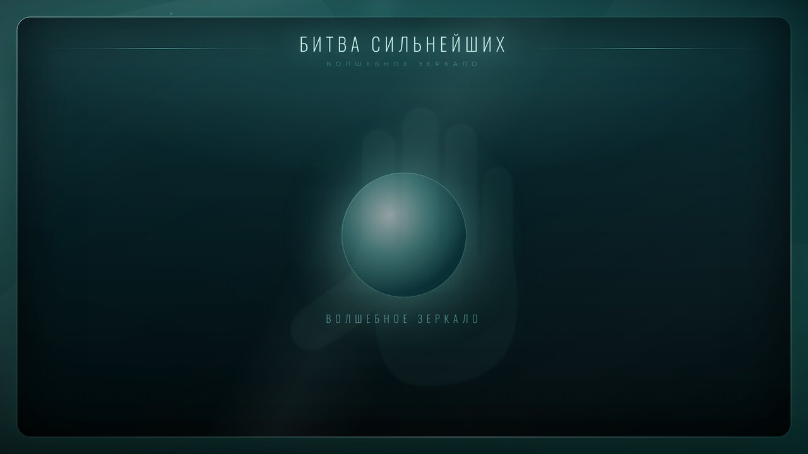

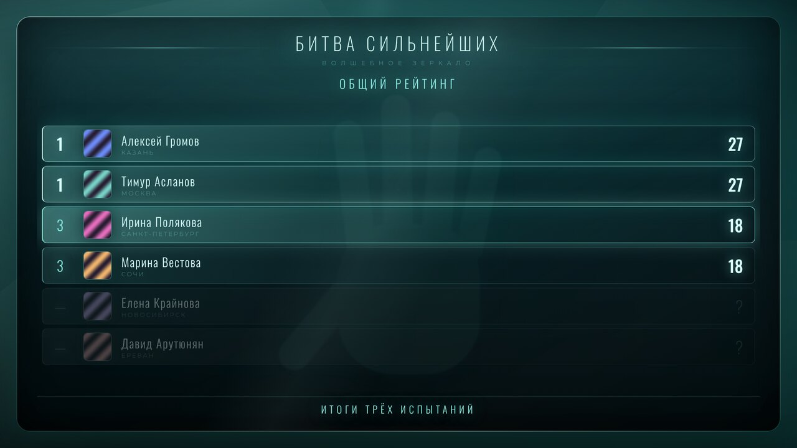

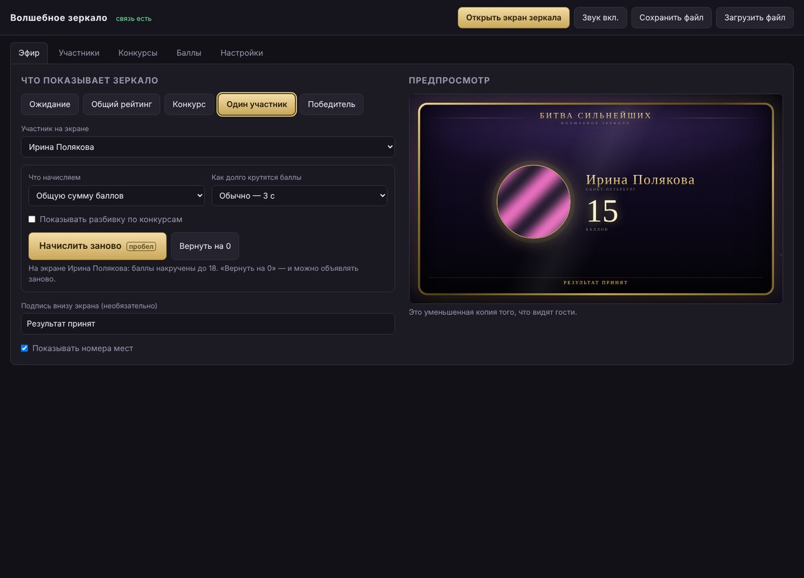

## Что умеет

**Пульт на ноутбуке:**
- библиотека шоу: заготовки с участниками, конкурсами и баллами, между которыми
  переключаются в один клик (см. ниже);
- участники: имя, подпись (город/регалии), фото (файл или перетаскивание), пометка «выбыл»;
- конкурсы: сколько угодно, у каждого свой **тип** — он решает, как начисляются
  баллы (чёрный ящик, рулетка, книги, стаканы, блиц, финал);
- баллы: карточка на каждого участника с кнопками своего конкурса, сумма
  считается сама, минусовые баллы поддерживаются;
- жеребьёвка: тройки, очередь и финальный вызов — с барабаном на экране;
- предпросмотр того, что сейчас на телевизоре;
- сохранение и загрузка всего шоу в файл.

**Экран зеркала (телевизор):**
- **Ожидание** — заставка с мерцающим шаром;
- **Общий рейтинг** — все участники по сумме баллов;
- **Конкурс** — результаты одного конкурса;
- **Задание** — название и описание того, что сейчас делают участники;
- **Жеребьёвка** — барабан с именами: тройки, очередь или вызов к финалисту;
- **Один участник** — крупный портрет и счётчик баллов от нуля (см. ниже);
- **Победитель** — то же самое с короной;
- **Предсказание** — случайное предсказание гостю;
- подпись внизу экрана (например, «Голосование жюри»);
- звук: музыка на каждом экране, щелчки счётчика, удар на финале,
  фанфары победителю.

**Открытие баллов.** Баллы можно внести заранее — на экране вместо них будет «?»,
а участники будут стоять внизу списка. Кнопка **«Открыть следующего»** (или пробел)
открывает очередного участника, начиная с последнего места: его оценка вспыхивает,
и строка плавно переезжает на своё место в рейтинге. Это и есть эффект «зеркала».

## Готовое шоу в комплекте

В библиотеке уже лежит шоу **«Битва сильнейших — 10 гостей»**: десять участников,
все шесть конкурсов с описаниями и типами начисления, 64 вопроса блица,
собранных по презентациям гостей, и 24 предсказания. Открывается кнопкой
«Открыть» на вкладке «Шоу» — дальше остаётся только добавить фотографии.

## Библиотека шоу

Шоу можно подготовить заранее: внести участников с фото, конкурсы и даже баллы,
а в день съёмки просто открыть нужное.

Вкладка **«Шоу»** в пульте:
- **Создать пустое шоу** — заготовка под новую съёмку;
- **Открыть** — переключиться на сохранённое шоу (эфир при этом начинается
  с режима ожидания, баллы на экране закрыты);
- **Дублировать** — сделать копию, чтобы не портить оригинал;
- **Переименовать**, **Удалить**;
- **Сохранить как новое** — отложить текущее состояние отдельной заготовкой.

Отдельно нажимать «сохранить» не нужно: всё, что вы меняете, само складывается
в открытое шоу. Название текущего шоу видно в верхней строке пульта.

Что хранится в шоу: участники, их фото и подписи, список конкурсов с их типами,
баллы и отметки, жеребьёвка, предсказания и заголовок экрана. Что не хранится:
режим эфира и раскрытые оценки (это начинается заново каждый раз) и настройки
звука — они относятся к технике, а не к шоу.

Каждое шоу лежит отдельным файлом в `data/shows/`. Файл можно скопировать
на другой ноутбук вместе с папкой `photos`.

## Типы конкурсов и начисление баллов

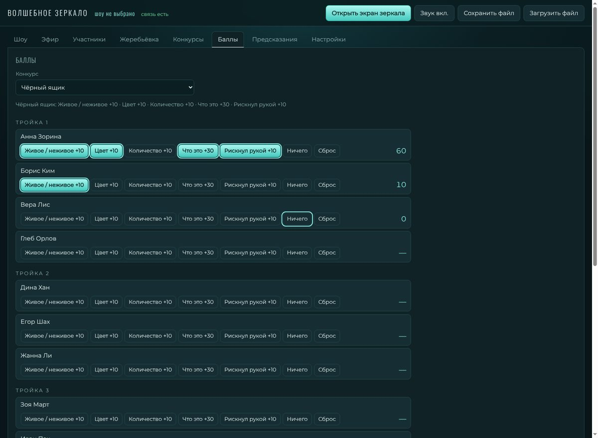

У каждого конкурса на вкладке **«Конкурсы»** выбирается тип. От него зависит,
что ведущий видит на вкладке **«Баллы»**: вместо голого поля с цифрой —
кнопки именно этого испытания.

| Тип | Что начисляется |
| --- | --- |
| **Чёрный ящик** | живое/неживое 10 · цвет 10 · количество 10 · что это 30 · рискнул рукой 10 |
| **Русская рулетка** | угадал 20 · мимо 0 |
| **Книжный червь** | нашёл деньги 30 · пустая книга 10 · нашёл 50 ₽ +50 |
| **Стаканы** | победный 20 · обычный 5 · отравленный −10 · отказался 0 |
| **Блиц** | каждый правильный ответ +10 (кнопки «+10» и «−»), плюс список вопросов |
| **Финал** | угадал 30 · не угадал 0 |
| **Обычный конкурс** | просто поле для ввода баллов |

На карточке участника есть ещё две кнопки: **«Ничего»** ставит ноль (участвовал,
но не взял ни одного балла) и **«Сброс»** убирает оценку совсем — на экране снова
будет «?». Внизу вкладки — общий зачёт: участники × конкурсы и сумма.

Если для конкурса проводилась жеребьёвка, карточки сразу разложены по тройкам —
ведущему не приходится искать нужных людей в общем списке.

## Блиц

У конкурса типа «Блиц» на вкладке **«Конкурсы»** появляется поле для вопросов —
по одному в строке, вопрос и ответ разделяются вертикальной чертой:

```
Кто пришёл на Хеллоуин в костюме бревна? | Аделя
Кто носит трусы с акулами? | Никита
```

Во время игры вкладка **«Баллы»** → конкурс «Блиц» показывает окно ведения:
текущий вопрос, кнопки **«Вопрос на экран»**, **«Показать ответ»**,
**«Следующий вопрос»** и **«← Предыдущий»**. Ответ в пульте до нажатия скрыт,
так что подсмотреть его через плечо не получится.

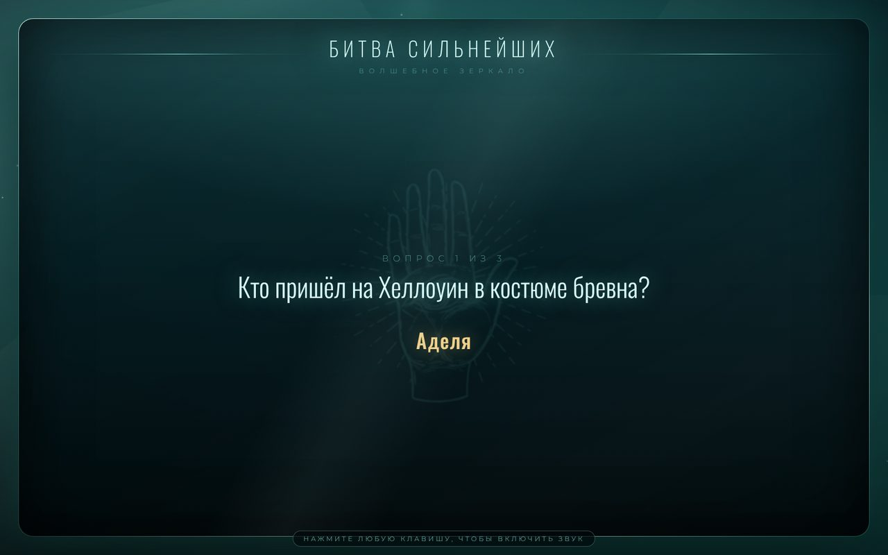

На зеркале видно номер вопроса, сам вопрос и — по команде — ответ.
Отвечает тот, кто первым выкрикнул: ведущий жмёт **«+10»** на карточке
этого гостя прямо под окном ведения.

## Жеребьёвка

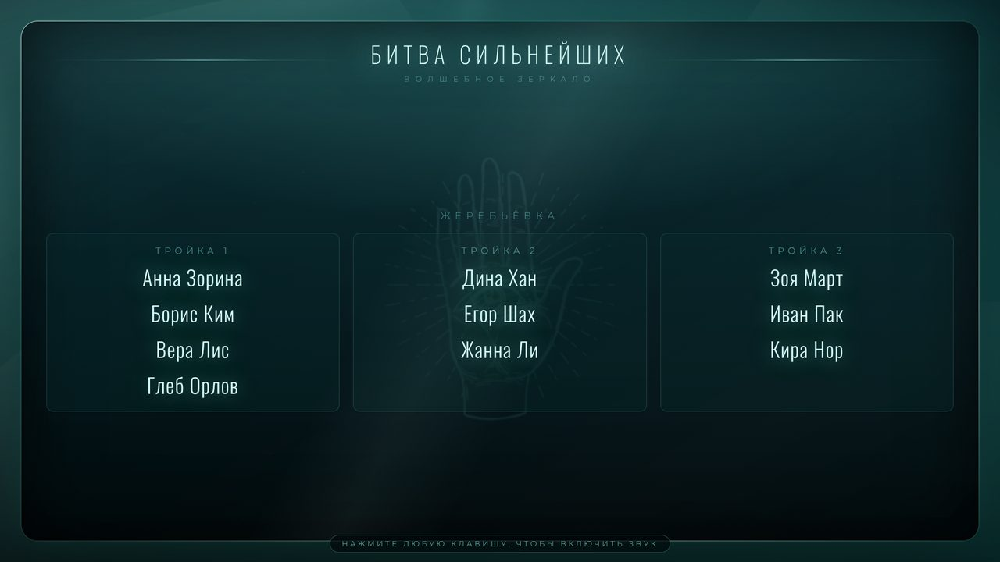

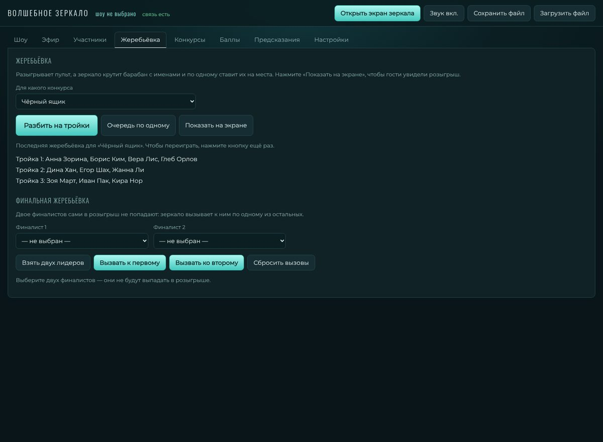

Вкладка **«Жеребьёвка»**. Разыгрывает пульт, а зеркало показывает барабан:
имена мелькают и по одному встают на места под щелчки.

- **«Разбить на тройки»** — случайные тройки из всех играющих. Если участников
  не кратно трём, лишние расходятся по группам: десять человек дают 4 + 3 + 3,
  а не три тройки и одиночку.
- **«Очередь по одному»** — случайный порядок всех участников: кто за кем берёт
  книгу, стакан или пистолет.
- **«Показать на экране»** — прокрутить барабан заново, не меняя результат.

Жеребьёвка привязывается к выбранному конкурсу, поэтому вкладка «Баллы»
потом раскладывает карточки по этим же тройкам.

**Финальная жеребьёвка.** Выберите двух финалистов (или нажмите
**«Взять двух лидеров»** — программа возьмёт первых по сумме баллов). Дальше
кнопки **«Вызвать к первому»** и **«Вызвать ко второму»** по одному выводят к ним
случайных участников. Сами финалисты в розыгрыш не попадают, и один человек
не выходит к обоим. **«Сбросить вызовы»** начинает круг заново.

## Экран задания

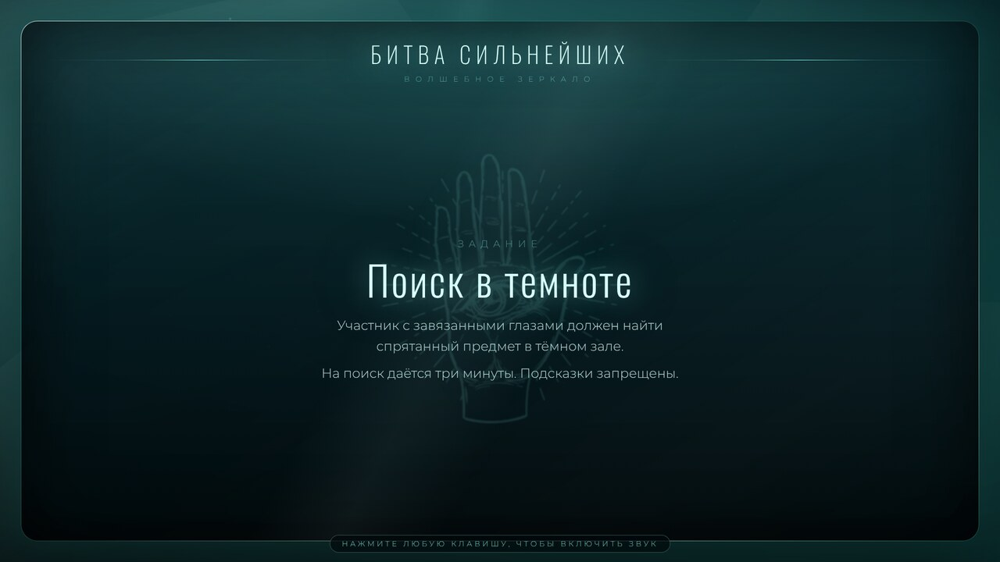

Чтобы показать гостям, что сейчас происходит, у конкурса есть **название
и описание**. На вкладке **«Конкурсы»** под каждым конкурсом поле для описания —
пара строк о том, что делают участники.

Вывести на экран можно двумя способами:

- **«Задание на экран»** — крупное название и описание (режим **«Задание»**);
- **«Итоги на экран»** — таблица с баллами за этот конкурс (режим **«Итоги конкурса»**).

Те же режимы есть на вкладке **«Эфир»**, там же выбирается, какой именно конкурс
показывать.

## Предсказания гостям

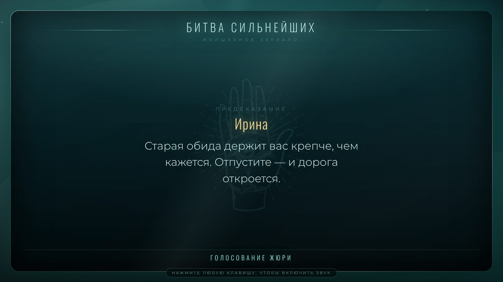

Финальный номер: зеркало вытягивает гостю случайное предсказание и показывает
его на экране.

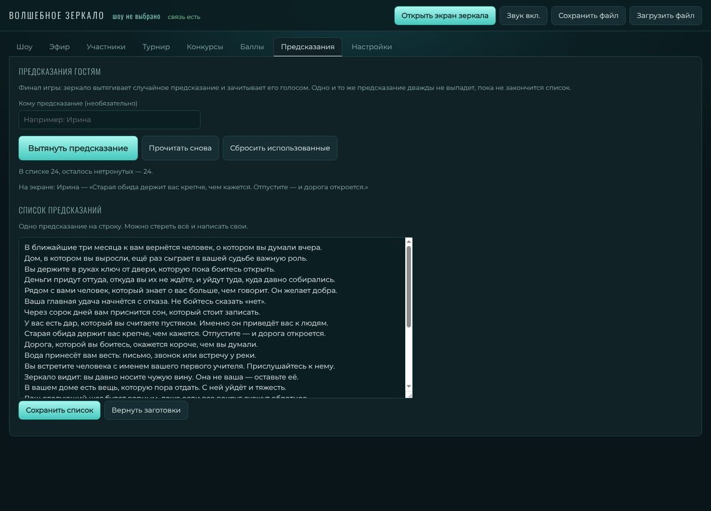

Вкладка **«Предсказания»**:

- **«Кому предсказание»** — имя гостя, оно появится над текстом (можно не вписывать);
- **«Вытянуть предсказание»** — случайное из списка: экран переключается на режим
  «Предсказание», и текст медленно проявляется;
- **«Прочитать снова»** — вернуть на экран то, что уже выпало;
- одно и то же предсказание дважды не выпадет, пока не кончится список;
  **«Сбросить использованные»** начинает круг заново;
- внизу сам список — одно предсказание на строку. В комплекте 24 заготовки,
  их можно стереть и написать свои, кнопка **«Вернуть заготовки»** возвращает исходные.

Список предсказаний хранится вместе с шоу, так что у каждого шоу в библиотеке
он может быть свой.

## Объявление результата

Отдельный режим для момента «называют участника и объявляют его баллы».
На экране остаётся только портрет слева и число справа — и по нажатию кнопки
(или пробела) баллы накручиваются от нуля до нужной цифры, замедляясь к финалу,
под щелчки счётчика и удар гонга на остановке. Когда счётчик замирает,
под числом появляется место участника.

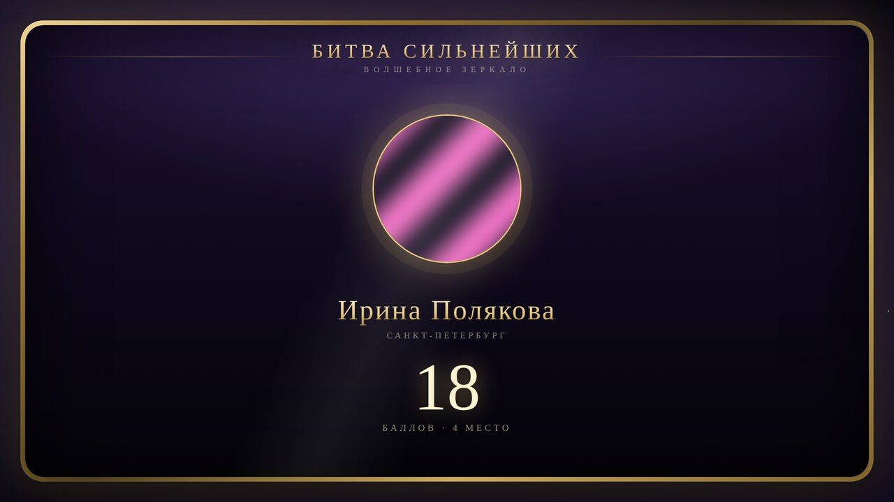

Настраивается на вкладке **Эфир** → режим **«Один участник»**:
- **что начисляем** — общую сумму или баллы за конкретный конкурс;
- **как долго крутятся баллы** — от 1,5 до 8 секунд;
- **«Начислить баллы»** (или пробел) — запуск; **«Вернуть на 0»** — показать заново;
- разбивку по конкурсам можно включить галочкой, по умолчанию её нет —
  чтобы на экране ничего не отвлекало от портрета и цифры.

При переключении на другого участника счётчик сам возвращается к нулю,
так что случайно показать результат заранее не получится.

## Установка

1. Поставьте [Node.js](https://nodejs.org) (версия 18 или новее, подойдёт LTS).
2. Скачайте эту папку на ноутбук.
3. Запустите:
   - macOS — двойной клик по `start.command`;
   - Windows — двойной клик по `start.bat`;
   - или в терминале из папки проекта: `node server.js`.

В окне терминала появятся адреса. Терминал во время шоу закрывать нельзя.

## Подключение телевизора

1. Соедините ноутбук и телевизор кабелем HDMI.
2. В настройках экрана выберите **расширить рабочий стол** (не «дублировать»):
   - Windows: `Win + P` → «Расширить»;
   - macOS: Системные настройки → Мониторы → выключить «Включить видеоповтор».
3. Пульт откроется в браузере сам. Если нет — адрес напечатан в окне терминала
   (`http://localhost:7777/admin.html`, или следующий порт, когда этот занят).
4. Нажмите **«Открыть экран зеркала»**, перетащите новое окно на телевизор
   и нажмите в нём клавишу **F** (или F11) — окно развернётся во весь экран.
   Курсор на экране зеркала не виден.

Пульт остаётся на ноутбуке, зеркало — на телевизоре. Всё, что меняется на пульте,
появляется на телевизоре мгновенно.

### Звук

Звук идёт из окна зеркала, то есть через тот же HDMI на динамики телевизора.
Два условия:

1. В настройках звука ноутбука выберите устройство вывода — телевизор (HDMI).
2. Браузер не включает звук, пока в окне ничего не нажали. Нажмите в окне зеркала
   клавишу **F** (ту же, что разворачивает на весь экран) — звук разблокируется.
   Пока он заблокирован, внизу экрана висит подсказка.

### Музыка заданий

Положите свои треки в папку **`public/music/tasks`** — программа прочитает её сама
и раздаст конкурсам по очереди: первому конкурсу первый файл по алфавиту,
второму второй и так далее. Если файлов меньше, чем конкурсов, они пойдут по кругу.
Каждый трек зацикливается с той же плавной склейкой.

Музыка звучит на всех экранах, а не только во время задания:

- **Ожидание** — свой файл `standby.mp3`;
- **Задание** и **Итоги конкурса** — трек этого конкурса;
- остальные экраны — трек текущего конкурса, а если он не выбран, первый файл
  из папки. Когда музыки заданий нет совсем, играет заставка — экран не молчит.

- конкретный трек для конкурса выбирается на вкладке **«Конкурсы»**
  (там же есть «Без музыки»);
- выключатель и громкость музыки заданий — на вкладке **«Настройки»**;
- добавили файлы при запущенной программе — нажмите там же «Перечитать папку».

Подойдут mp3, m4a, wav, ogg. Имена файлов любые, в том числе русские.

### Музыка ожидания

На **экране ожидания** играет музыка — файл `public/music/standby.mp3`.
Замените его своим, чтобы поставить другую мелодию: подойдёт любой mp3.
Короткая запись зацикливается с плавной склейкой, поэтому стык не слышен.
Выключатель и отдельная громкость музыки — на вкладке **Настройки**.

Что ещё звучит: щелчки при накрутке баллов (ускоряются и замедляются вместе с числом),
удар гонга в момент остановки, переливы при открытии оценок в рейтинге,
шорох при смене картинки и фанфары при объявлении победителя.
Громкость, выключатель и кнопка проверки — на вкладке **Настройки**,
быстрый выключатель звука — в верхней строке пульта. Он гасит и музыку тоже.

Звуки не скачиваются и не лежат файлами — они синтезируются прямо в браузере,
поэтому программа остаётся офлайновой. Тембры правятся в `public/sound.js`.

### Пульт в телефоне или планшете

Если телефон в той же Wi-Fi-сети, откройте на нём адрес вида `http://192.168.x.x:7777/admin.html`
(точный адрес сервер печатает при запуске). Тогда ведущий может открывать баллы
прямо со сцены. Пультов может быть несколько, они синхронизируются.

## Как вести эфир

1. До игры: вкладки **Участники** и **Конкурсы** — внесите всех и все испытания,
   у каждого конкурса выберите тип и впишите описание.
2. Перед конкурсом: вкладка **Жеребьёвка** — «Разбить на тройки» (или «Очередь»),
   зеркало крутит барабан.
3. Во время конкурса: вкладка **Конкурсы** → «Задание на экран», чтобы гости
   видели название и описание.
4. После каждой тройки: вкладка **Баллы** — отметьте, кто что угадал,
   затем **Эфир** → «Итоги конкурса» и открывайте участников по одному
   кнопкой «Открыть следующего» или пробелом.
5. Объявление результата одного участника — режим **«Один участник»**
   и кнопка «Начислить баллы»: счётчик крутится от нуля.
6. Финал: вкладка **Жеребьёвка** → «Взять двух лидеров» → «Вызвать к первому»
   и «Вызвать ко второму».
7. Победитель — режим **Победитель**, затем вкладка **Предсказания**.

## Данные

Всё хранится на вашем ноутбуке:
- `data/state.json` — участники, конкурсы, баллы и состояние экрана;
- `data/photos/` — загруженные фотографии;
- `data/shows/` — сохранённые шоу из библиотеки.

Состояние сохраняется автоматически, а при закрытии терминала (Ctrl+C)
дописывается последняя правка — так что ни закрытый терминал, ни перезагрузка
ноутбука ничего не теряют: запустите сервер снова, и всё на месте.
Перед шоу полезно нажать **«Сохранить файл»** и положить резервную копию в надёжное место.

## Оформление

Стиль собран по заставкам «Битвы экстрасенсов»: бирюзовый туман, лучи,
кристальные осколки, знак ладони за содержимым и узкие прописные.

- Шрифты — **Oswald** (заголовки, имена, цифры) и **Montserrat** (подписи).
  Они лежат в `public/fonts/` и не скачиваются из интернета.
- Палитра задана переменными в начале `public/display.css`
  (`--aqua`, `--aqua-deep`, `--gold` для победителя). Поменяйте их — поменяется весь экран.
- Знак ладони — `public/hand.svg` (векторная обводка рисунка, белый фон убран,
  цвет линий `#8df0e6` задан прямо в файле). Размер, прозрачность и пульсацию
  правит правило `.hand` в `display.css`.
- Пульт собран в той же палитре, переменные в начале `public/admin.css`.

## Настройка

- Заголовок и подзаголовок экрана — вкладка **Настройки**.
- Порт по умолчанию 7777. Если он занят: `PORT=8080 node server.js`.
- Звуки — `public/sound.js`, каждый собран из нескольких генераторов, менять можно по одному.
- Музыка ожидания — `public/music/standby.mp3`, просто замените файл.
- Музыка заданий — любые файлы в `public/music/tasks`, порядок по алфавиту.
- Оформление экрана целиком лежит в `public/display.css` — цвета, фон,
  шрифты и размеры можно менять там, не трогая логику.

## Проверка после правок

Если будете что-то менять в коде, есть автотесты: они поднимают сервер на отдельном порту
и гоняют в Chrome сначала пульт (участники, баллы, открытие оценок, начисление, звук),
потом сам экран зеркала (счётчик, щелчки, посадка списка по высоте).

```
npm test
```

## Если что-то пошло не так

| Симптом | Что делать |
|---|---|
| На экране зеркала надпись «Нет связи с пультом» | Терминал с сервером закрыт — запустите снова |
| Окно терминала мигнуло и закрылось | Не найден Node.js — поставьте его с nodejs.org и запустите снова |
| Страница не открывается | Адрес печатается в окне терминала: если 7777 занят, берётся следующий свободный |
| Телевизор показывает то же, что ноутбук | Включите режим «Расширить», а не «Дублировать» |
| Фото не загружается | Нужен файл JPG, PNG или WebP |
| Список участников мелкий | Так и задумано: при большом числе участников строки сжимаются, чтобы влезли все |
| Счётчик сразу показывает итог | Нажмите «Вернуть на 0» — и объявляйте заново |
| Нет звука | Нажмите клавишу в окне зеркала (снизу висит подсказка) и проверьте, что звук ноутбука выведен на HDMI |
| Звук двоится | Так и должно быть только на телевизоре: предпросмотр на пульте всегда беззвучный |
